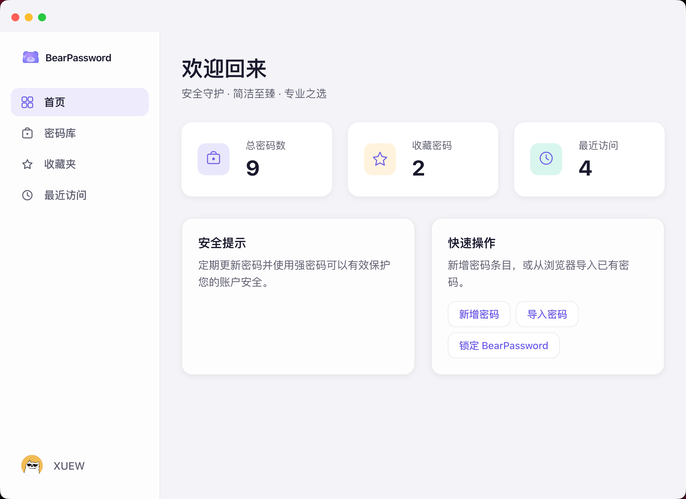
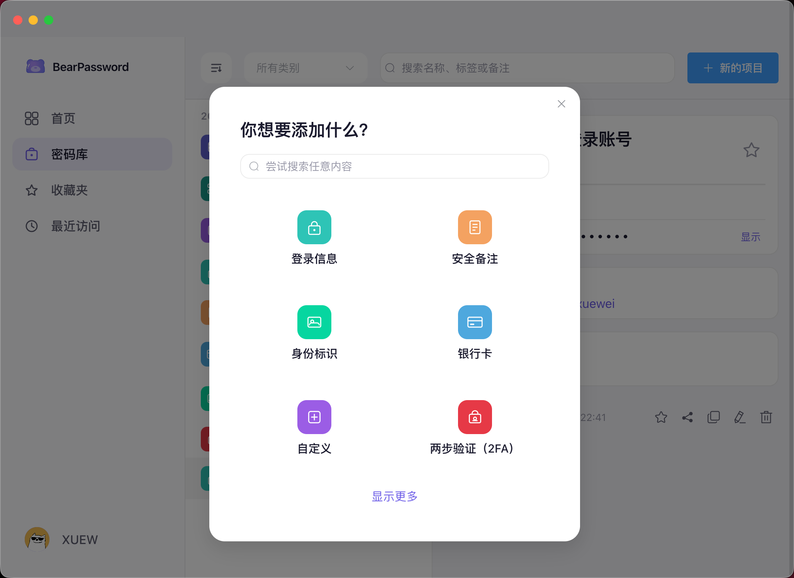
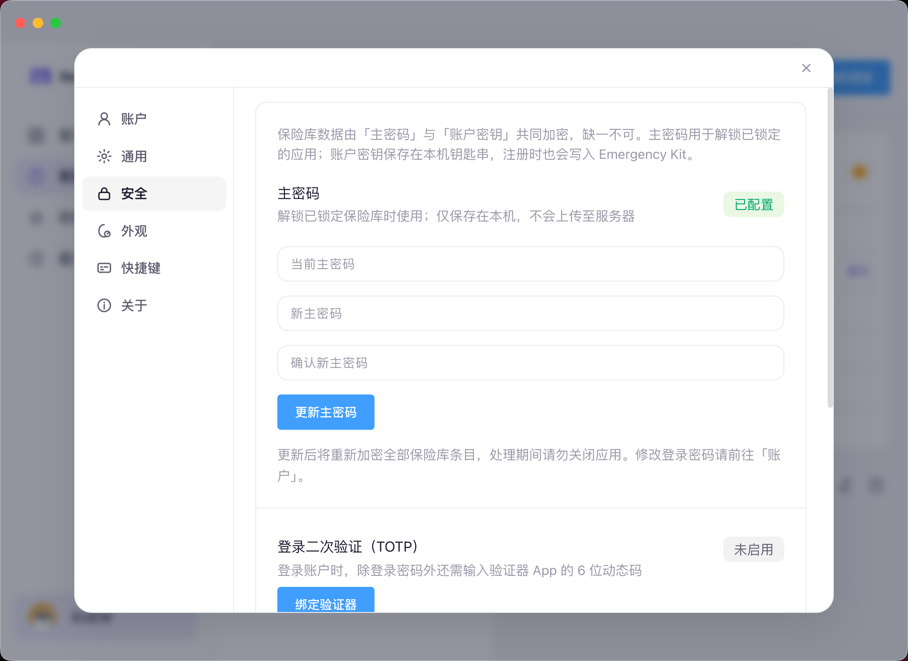
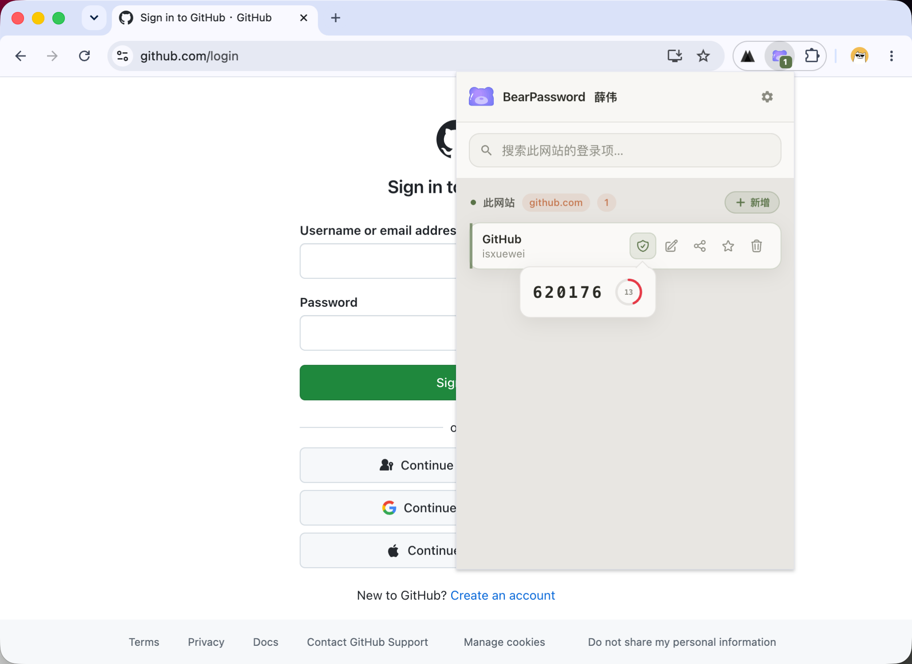
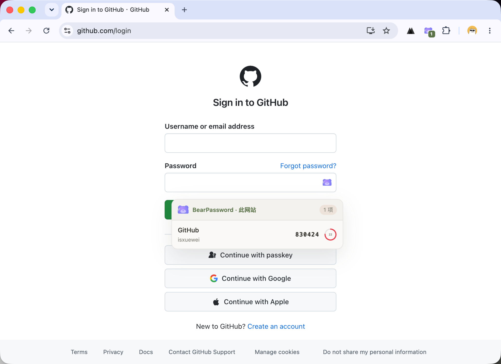
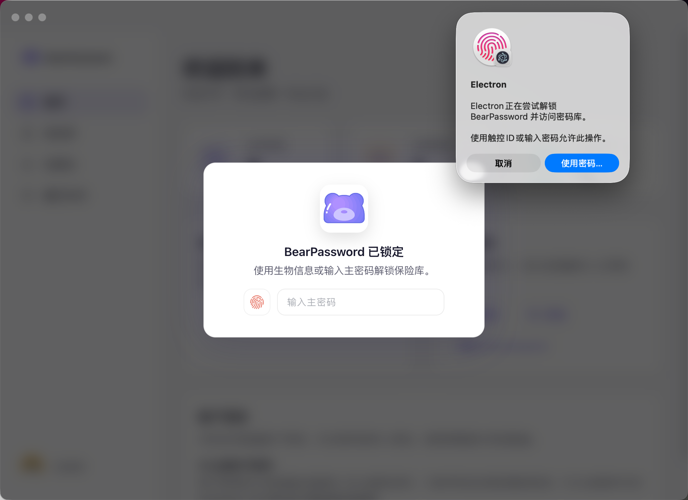

# BearPassword 产品介绍源稿

## 产品一句话
BearPassword 是一套简洁、安全、专业的密码管理工具，由桌面端与浏览器扩展配合使用，帮助用户安心保存账号、密码、敏感信息与两步验证码，并在网页登录时一键填充。

## 核心定位
- 面向需要在多网站、多账号环境中管理敏感信息的个人用户、开发者与自建服务用户。
- 强调“桌面端集中管理 + 浏览器扩展便捷填充 + 本地加密后同步”的完整闭环。
- 官网地址：https://bear-password.xuewei.fun

## 典型使用流程
1. 从官网下载并安装 BearPassword 桌面端，支持 macOS、Windows。
2. 注册账号，设置主密码，解锁保险库；建议同时配置安全密钥。
3. 安装 Chrome / Edge 浏览器扩展。
4. 日常保持桌面端在后台运行并已解锁，即可在网页中自动填充账号密码。

## 产品架构
| 模块 | 面向对象 | 说明 |
|---|---|---|
| 桌面客户端 | 所有用户 | 管理密码库、生成强密码、查看两步验证码、配置安全策略 |
| 浏览器扩展 | 所有用户 | 在网页登录页匹配条目、一键填充、查看/复制 TOTP、快捷保存新登录 |
| 服务端 | 云服务/自建用户 | 账号登录、保险库密文同步、收藏、公告、版本更新 |
| 官网静态页 | 新用户 | 产品下载、功能展示与使用引导 |

## 桌面端能力
- 保存多种敏感信息：登录信息、安全备注、身份、银行卡、服务器、数据库、两步验证、自定义条目。
- 登录条目可扩展字段：URL、邮箱、地址、电话、备用密码、两步验证等。
- 支持 TOTP：通过密钥、二维码识别导入，在详情页实时显示验证码与倒计时。
- 安全策略：主密码 + 可选安全密钥、自动锁定、剪贴板定时清空、可选生物识别解锁。
- 使用体验：收藏夹、最近访问、标签、搜索、多主题、中/英/日界面。

## 浏览器扩展能力
- 智能匹配：根据当前网站自动列出可用登录项，工具栏徽章显示可用数量。
- 一键填充：点击输入框旁图标，或打开扩展弹窗选择条目即可填入用户名与密码。
- 二次验证：弹窗和网页填充层可显示实时验证码；选择条目填充时可自动复制当前 TOTP 到剪贴板。
- 快捷保存：检测到新登录信息时提示保存到保险库。
- 右键菜单：可在输入框中生成强密码。

## 安全与隐私说明
- 保险库内容在设备上加密后才会上传或同步，服务器存储的是密文。
- 主密码不会明文上传到服务器。
- 扩展通过本机安全通道与桌面端通信，不会单独保存用户主密码。
- 桌面端未运行或保险库未解锁时，扩展无法解密和填充条目。
- 两步验证码在本地根据密钥实时计算，不会把密钥发给网站。

## 技术与部署
- 桌面端：Electron、Vue 3、TypeScript、Pinia、Element Plus、Vite。
- 浏览器扩展：Manifest V3、Vue 3、TypeScript、Vite、CRXJS。
- 服务端：Java 17、Spring Boot 3、MyBatis Plus、MySQL、Druid。
- 开发者可自建服务端；普通用户使用官网云服务即可。

## 适合在 PPT 中展示的截图

## 建议叙事结构
1. 开场：密码管理痛点与 BearPassword 的产品定位。
2. 总览：桌面端 + 扩展 + 服务端构成完整闭环。
3. 桌面端：保险库、条目类型、TOTP、安全设置。
4. 扩展端：自动匹配、一键填充、实时 TOTP、快捷保存。
5. 安全设计：本地加密、主密码保护、本机通信、密文同步。
6. 技术与使用场景：跨平台、开发者可自建、普通用户即装即用。
7. 结尾：简洁、安全、专业的个人密码管家。
